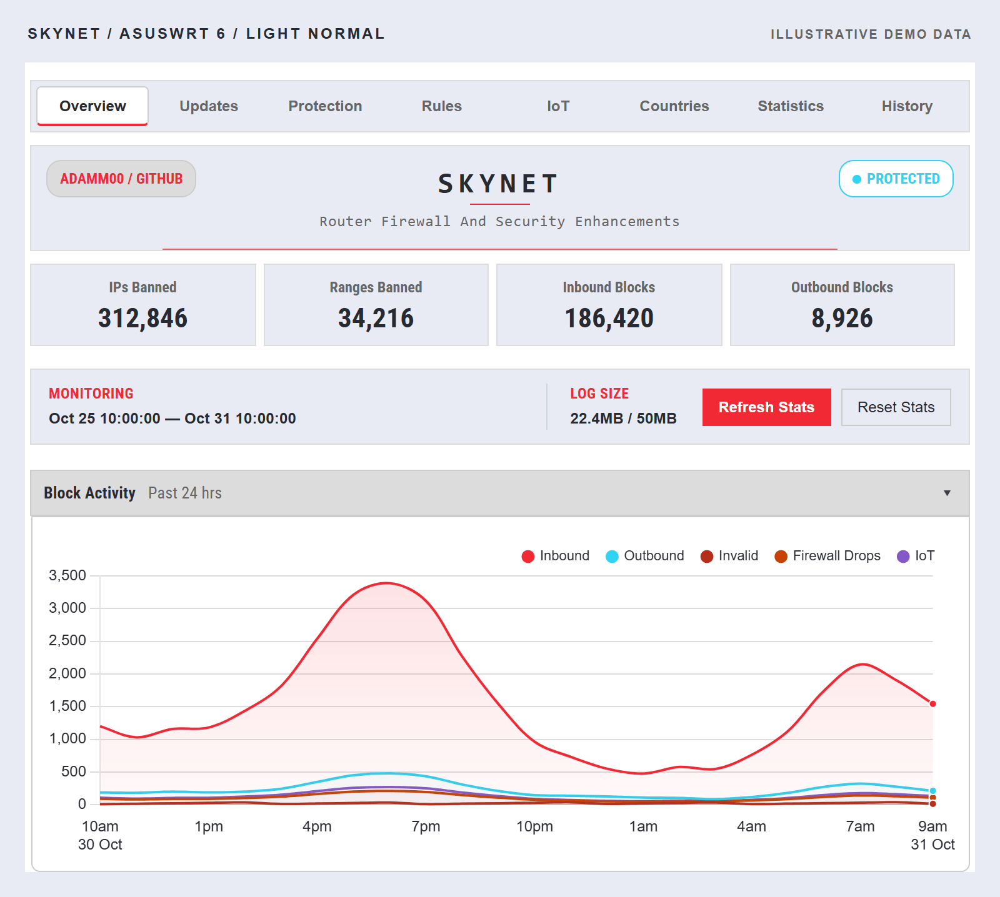
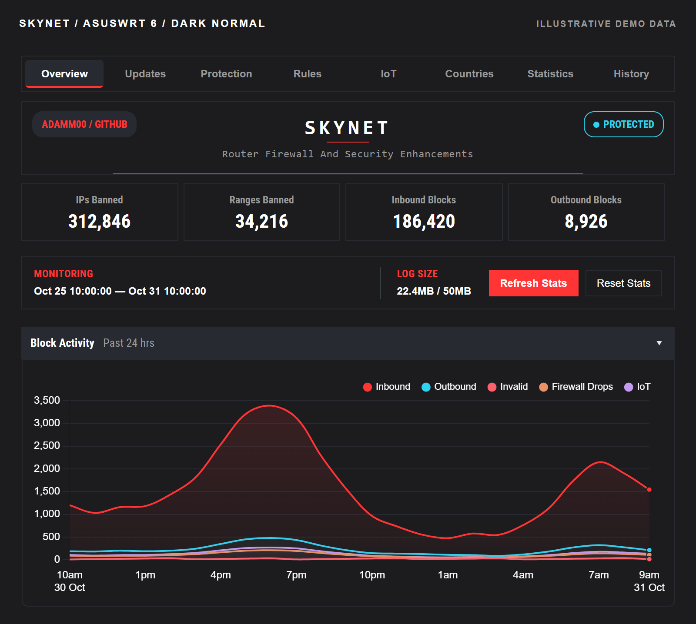
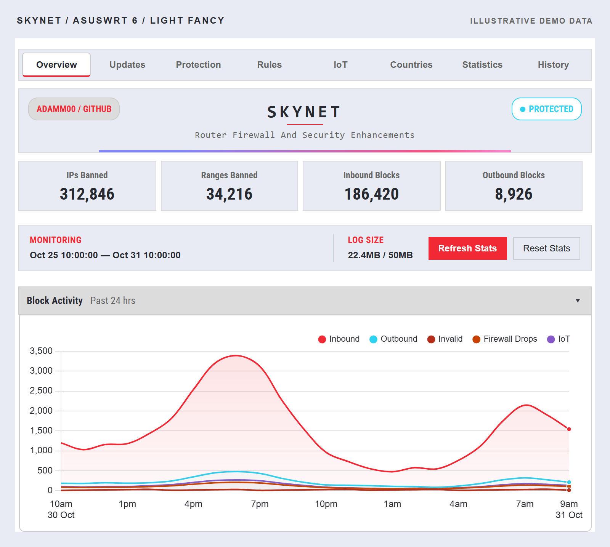
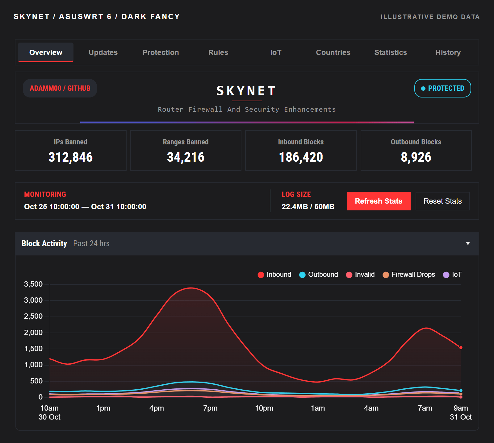

# WebUI compatibility

Skynet supports the classic Asuswrt-Merlin interface and AsusWRT 6 through
Merlin's Addons API. The interface is selected automatically. Both versions
manage the same settings, rules, statistics and history.

## Open Skynet

| Router interface | Menu location |
| --- | --- |
| Classic | **Firewall → Skynet** |
| AsusWRT 6 | **Settings → Firewall → Skynet** |

If the tab is missing, enable integration over SSH:

```sh
firewall settings webui enable
```

Allow a few seconds, then reload the router page. See
[troubleshooting](troubleshooting.md#skynet-is-missing-from-the-webui) if the tab
still does not appear.

## Appearance

On AsusWRT 6, Skynet follows **Configuration → Mode** (Light/Dark) and **Theme**
(Normal/Fancy). Panels, controls and charts update with the router's theme.
Chart selections are retained when the appearance changes.

The AsusWRT 6 previews below show the ROG appearance with fictional data.
Click an image for the full-size view.

| Theme | Light mode | Dark mode |
| --- | --- | --- |
| Normal | [](../assets/screenshots/asuswrt6-light.png) | [](../assets/screenshots/asuswrt6-dark.png) |
| Fancy | [](../assets/screenshots/asuswrt6-fancy-light.png) | [](../assets/screenshots/asuswrt6-fancy-dark.png) |

[View the classic interface gallery](../README.md#explore-the-interface).

## Updates

Keep the Skynet script and WebUI on matching versions. After a firmware change,
update Skynet and reload the router page to refresh its navigation.

See [getting started](getting-started.md#install-or-update) for update
instructions and [the WebUI guide](webui.md) for daily use.
